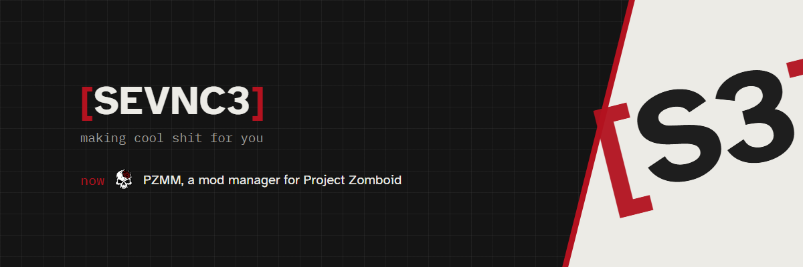
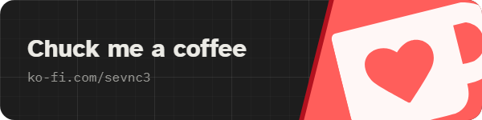

I'm Luke. Mods, tools, whatever I'm into at the time.

Right now: [PZMM](https://github.com/SEVNC3/pz-mod-manager), a free mod manager for Project Zomboid. It sets up Project Viewpoint for you too.

